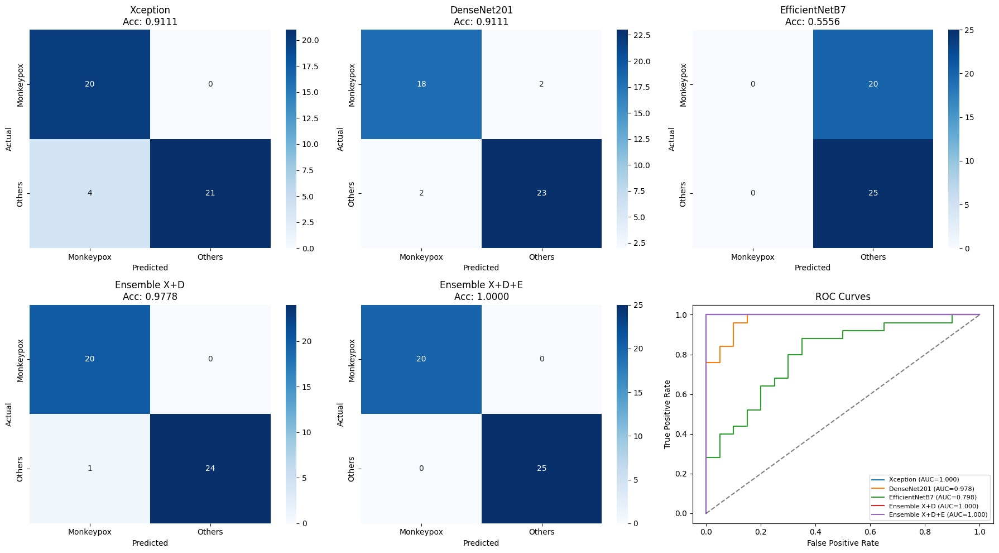
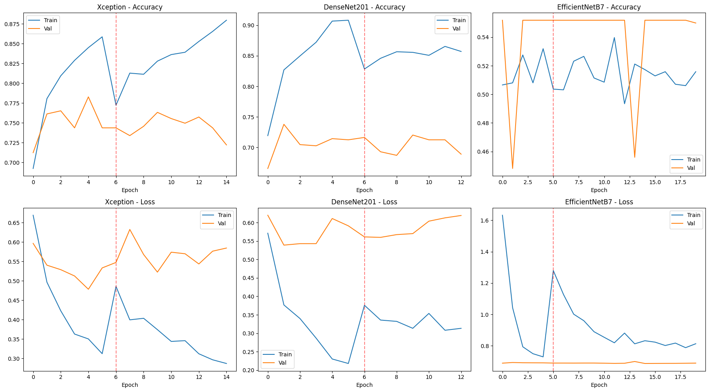
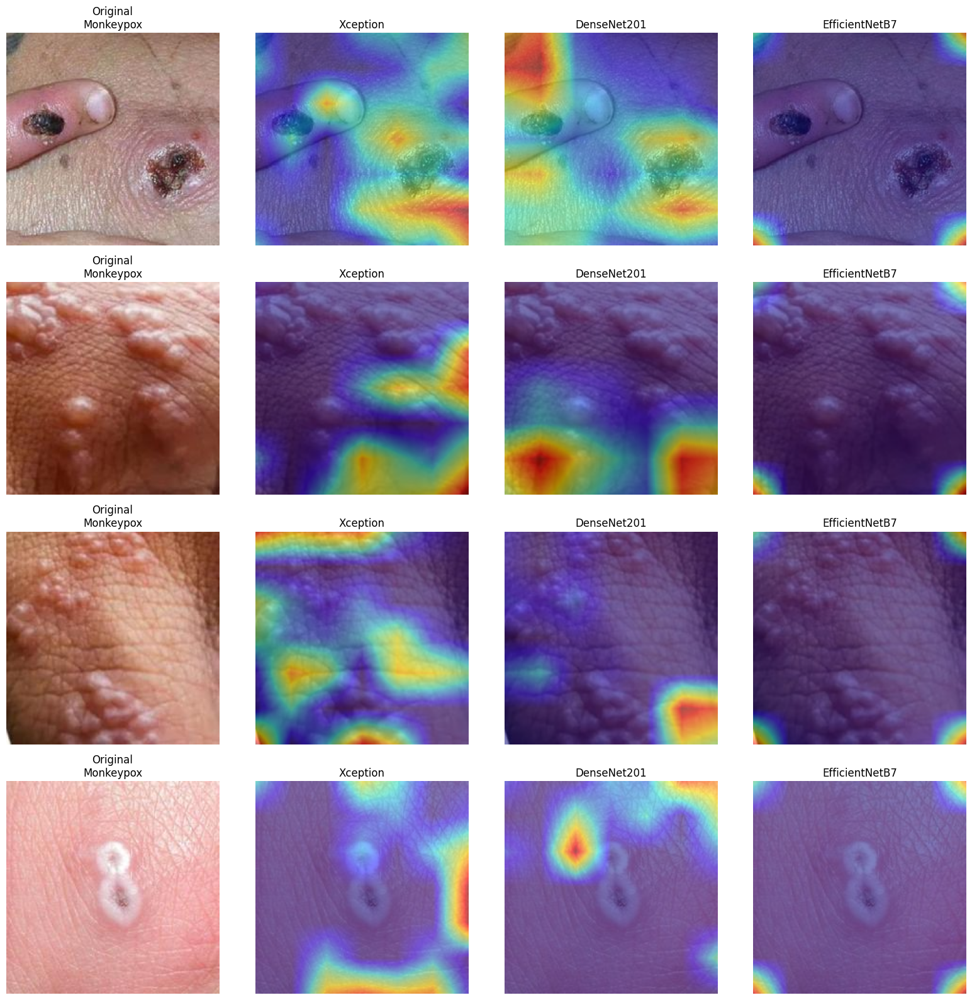

# Monkeypox Detection from Skin Images — Deep Ensemble + Grad-CAM

Binary classification (Monkeypox vs Others) on skin-lesion images using transfer learning with **Xception**, **DenseNet201** and **EfficientNetB7**, combined by soft voting, with **Grad-CAM** for explainability.

Course project — Dept. of AI & ML, Symbiosis Institute of Technology (Practical 12: Project / Case Study on Classification).
Author: Vedant Chavan

## Overview
- **Dataset:** Monkeypox Skin Image Dataset (MSID) — [Kaggle](https://www.kaggle.com/datasets/dipuiucse/monkeypoxskinimagedataset) (Bala et al., 2023). Not included in this repo.
- **Approach:** ImageNet-pretrained backbones, two-stage training (train head, then fine-tune top layers at lr = 1e-5), soft-voting ensemble `P = (P_X + P_D + P_E) / 3`.
- **Explainability:** Grad-CAM heatmaps via `tf-keras-vis` (qualitative, with limitations noted below).
- **Framework:** TensorFlow / Keras on Google Colab (T4 GPU).

## Results (45-image test set)

| Model | Accuracy | Precision | Recall | F1 | AUC |
|---|---|---|---|---|---|
| Xception | 91.11% | 100% | 84% | 91.30% | 1.000 |
| DenseNet201 | 91.11% | 92% | 92% | 92.00% | 0.978 |
| EfficientNetB7 | 55.56% | 55.56% | 100% | 71.43% | 0.798 |
| Ensemble (X + D) | 97.78% | 100% | 96% | 97.96% | 1.000 |
| Ensemble (X + D + E) | 100% | 100% | 100% | 100% | 1.000 |

**Caveats:** the test set is only 45 images, so these numbers carry little statistical weight. EfficientNetB7 failed to learn (input-resolution/preprocessing mismatch), and DenseNet201 shows overfitting. See the report for full analysis, literature review and limitations.

### Confusion matrices and ROC curves


### Training curves (dashed line = start of fine-tuning)


### Grad-CAM heatmaps


**Interpretation:** Xception and DenseNet201 heatmaps are only partially lesion-aligned — they sometimes highlight lesion areas but often attend to image borders or plain skin, so they are not reliable evidence of clinical relevance. EfficientNetB7 activates mostly at image corners, consistent with its failed training. Further work (more samples, other XAI methods such as LIME / Integrated Gradients) is needed before drawing conclusions.

## Repository structure
```
├── notebooks/monkeypox_ensemble_gradcam.ipynb   # full pipeline (Colab)
├── report/Practical12_Monkeypox_Report.pdf      # project report
├── results/                                     # confusion matrices, training curves, Grad-CAM
├── requirements.txt
└── README.md
```

## How to run
1. Download MSID from Kaggle and upload `archive.zip` to Colab (or mount Drive).
2. Open the notebook in Google Colab with a GPU runtime.
3. Run the cells top to bottom. The notebook uses Colab paths (`/content/dataset`, `/content/drive/MyDrive/Monkeypox_Project`) — change these if running locally.

## Future work
Larger test set / k-fold CV, retrain EfficientNetB7 at 600×600 with its own preprocessing, multi-class extension, LIME / Integrated Gradients, TFLite/ONNX deployment, cross-dataset validation.

## References
1. Saha et al. (2025). Mpox-XDE. *BMC Infectious Diseases*, 25(403).
2. Agrawal et al. (2026). B2MVIT. *Int. J. Computational Intelligence Systems*, 19(1).
3. Hossain et al. (2025). From survey to solution. *Array*, 27(100554).
4. Mustahid et al. (2026). MicroMPoxNet. *Biomed. Signal Processing and Control*, 123(110404).
5. Bala et al. (2023). MonkeyNet. *Neural Networks*, 161, 757–775.

> Research/educational use only — not a medical diagnostic tool.
